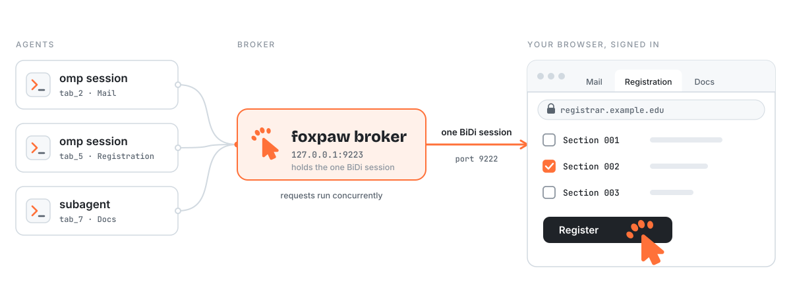

<p align="center">
  <picture>
    <source media="(prefers-color-scheme: dark)" srcset="docs/assets/logo-dark.svg">
    
  </picture>
</p>

<p align="center">
  An <a href="https://github.com/can1357/oh-my-pi">oh-my-pi</a> tool that lets an AI agent use the Zen or Firefox you already have open,<br>
  signed in, over WebDriver BiDi.
</p>

<p align="center">
  
  
  
  
  
</p>

<p align="center">
  <a href="#why">Why</a> ·
  <a href="#how-it-works">How it works</a> ·
  <a href="#what-the-agent-gets-back">Responses</a> ·
  <a href="#results">Results</a> ·
  <a href="#security">Security</a> ·
  <a href="#quick-start">Quick start</a> ·
  <a href="#cli">CLI</a> ·
  <a href="#reference">Reference</a>
</p>

<br>

## Why

Playwright and Selenium start their own clean browser. That's what you want for tests. It's useless when the page the agent needs is behind your login, and getting there again would mean SSO plus a two-factor prompt on your phone.

foxpaw connects to a Zen or Firefox you started yourself, with your profile and logins. The agent works in your real tabs, and you can watch it click.

Working in your own browser changes what a mistake costs. If the agent misreads a page in a test browser, you rerun the test. In yours, it might submit a form twice. Most of the code is there so the agent can tell what a click actually did before it decides what to do next.

## How it works

<picture>
  <source media="(prefers-color-scheme: dark)" srcset="docs/assets/how-it-works-dark.svg">
  
</picture>

Firefox only allows one WebDriver BiDi session at a time, so a small broker holds it and every agent session talks to the broker. Requests run concurrently, and each response goes back to the session that sent it. The broker starts with the first tool call and exits when the last session disconnects.

Programs that speak plain WebDriver BiDi can share the session too: they connect to `ws://127.0.0.1:9223/session` instead of Firefox's port. Each connection gets a session of its own. The broker answers `session.new` and `session.end` itself, and `session.status` reports that connection's view, so a client that checks its session was released still works. Everything else runs on the shared session, with these rules:

- A client only receives events from its own subscriptions, and only for the tabs it named. Events from an iframe count as its tab.
- A request held by a network intercept goes only to the client that added the intercept. A client that fails every held request it doesn't recognize (a submit guard does) would otherwise fail other clients' requests.
- When a client ends its session or disconnects, the broker fails the requests it was still holding, then removes its intercepts, preload scripts and subscriptions. A held request is never let through on a departed client's behalf.

The broker doesn't start on its own for these clients. Run `bun run broker`, or let a `zen_browser` call start it.

| Path | What it is |
| --- | --- |
| `extension/zen-browser.ts` | The `zen_browser` tool for oh-my-pi |
| `src/broker.ts` | The loopback broker that shares the BiDi session |
| `src/mux.ts` | Plain WebDriver BiDi on `/session`: one virtual session per connection over the shared one |
| `src/browser.ts` | `ZenBrowser`: tab targeting, keyboard and pointer input, dialogs, waits, screenshots |
| `src/locator.ts` | CSS, role, and accessible-name locators; each must match exactly one element |
| `src/cli.ts` | A CLI for one-off commands and debugging |

## What the agent gets back

| Question | Answer in the response |
| --- | --- |
| Did the input reach the page? | `actionPerformed`. If the target moved or re-rendered before the input went out, nothing is sent and it's `false`. |
| Does the field hold what I asked for? | `verified`. When the input went through but the field reads back differently, the response says `actionPerformed: true, verified: false` so the agent knows not to type it again. |
| Did the result show up? | `waitFor` goes on the action and starts listening before the click. If it times out, the response includes what the page shows instead. |
| Did a dialog open? | `openPrompt: { type, message }`. Other actions on that tab are refused until the agent answers with `dialog`. |
| Did the form submit? | Constraint validation runs first. An invalid form comes back as `submitted: false` with the fields that failed. |
| Is this the right tab? | Anything that can change a page needs a `tabId`. Leaving it out is an error, so the agent can't act on whatever tab you happen to be looking at. |

With `waitFor`, the agent doesn't need to `sleep` after a click. Clicking a Register button looks like this:

```json
{ "action": "click", "tabId": "tab_2", "handle": "el_41",
  "waitFor": { "anyOf": [{ "text": "Registration Results" }, { "text": "Error" }] } }
```

It returns as soon as either text appears, including inside same-origin iframes. If a spinner is the only signal, `"state": "hidden"` waits for it to go away.

## Results

Here is the tool run against a fixture page in an isolated container in Zen, making the same calls an agent would:

| Call | Response |
| --- | --- |
| `click` with no `tabId` | Refused; page-changing actions need a tab |
| Click a button that calls `confirm("Drop this section?")` | `actionPerformed: true`, `openPrompt: { type: "confirm", message: "Drop this section?" }` |
| `inspect` while that dialog is open | Refused, with the open dialog repeated |
| `dialog` accept | Handled; the page's `confirm()` returned `true` |
| `check` the box named "Section 002", where two boxes share the same CSS and id | Only that one ticked (`[false, true]`), `verified: true` |
| `select` "Spring" in a list with a disabled placeholder | `selectedIndex: 2`, one `change` event, `verified: true` |
| `select` the disabled option | Refused, nothing changed |
| `submit_form` with a required field empty | `submitted: false`, `invalidFields: [{ name: "email", validationMessage: "Please fill out this field." }]` |
| `click` + `waitFor` on text that appears 600 ms later | `waitCompleted: true` |
| `click` + `waitFor` on text that never appears | `actionPerformed: true`, `waitCompleted: false`, the error, and a page summary |

That's one fixture page, so treat it as a smoke test. Waits can't see into cross-origin iframes. The unit tests use fakes, and only the opt-in integration tests drive Firefox.

## Security

Firefox's Remote Agent has no authentication and no encryption. While it's running, any process on your machine that can reach the port can read and control every tab in that profile, including the ones you're signed in to. foxpaw can't fix that. Here's what it does to keep from making it worse.

Both clients refuse endpoints that aren't loopback, and the broker only binds to `127.0.0.1`.

Firefox's default for an automation session is to close `alert`, `confirm`, `prompt`, and "Leave site?" dialogs on its own, in every tab, including yours. foxpaw's session turns that off.

Checking which browser features exist only reads state. Disposable test containers from `open({ isolation: "test" })` are deleted when their last tab closes or the omp session ends.

Failure reports and event buffers drop cookie values, auth headers, token, password, and secret query parameters, request and response bodies, typed text, prompt text, and file paths.

Don't add `--remote-allow-hosts`, `--remote-allow-origins`, or `--remote-allow-system-access`, and restart the browser normally when you're done. Mozilla's [Security aspects of the Remote Agent](https://firefox-source-docs.mozilla.org/remote/Security.html) has the details.

## Quick start

You need [Bun](https://bun.sh) 1.x and Zen or Firefox with WebDriver BiDi; development happens on Zen Twilight. For the agent tool you also need [oh-my-pi](https://github.com/can1357/oh-my-pi).

Quit the browser first, because the flag only takes effect at startup. Your profile path is listed in `about:profiles`. The binary name depends on how you installed Zen (`zen`, `zen-twilight`, a Flatpak).

```sh
zen-twilight --remote-debugging-port=9222 --profile "$HOME/.zen/<profile>"
# Firefox: firefox --remote-debugging-port=9222 --profile "$HOME/.mozilla/firefox/<profile>"

git clone https://github.com/nunera/foxpaw.git
cd foxpaw
bun install
bun run start -- tabs        # prints your open tabs as JSON if it's working
bun run install-extension    # symlinks the tool into ~/.omp/agent/extensions/
```

omp loads extensions when a session starts, so open a new one after installing. The agent then calls `tabs` and keeps the `tabId`, calls `inspect` to get element handles (`el_*`), and acts on a handle or on a CSS `selector` with an optional `role` and `name`. A handle that no longer matches its element after a re-render fails as stale, so the agent can't click the wrong thing by accident.

## CLI

The CLI is for one-off commands and debugging. Each command opens a BiDi session, does one thing, and closes it. You pick a tab with a piece of its URL or title, and it has to match exactly one tab.

```sh
bun run start -- open https://example.com
bun run start -- fill duckduckgo.com 'input[name=q]' 'webdriver bidi'
bun run start -- press duckduckgo.com Enter 'input[name=q]'
bun run start -- wait-url duckduckgo.com '?q='
bun run start -- screenshot duckduckgo.com ./results.png
```

Run `bun run start` with no arguments to list every command. Selectors are CSS, and `>>>` crosses into open shadow roots (`yt-searchbox >>> textarea`). The CLI talks to Firefox directly, so it fails while the broker has the session. Close your omp sessions or stop the broker first.

## Reference

Every action and parameter is documented in [docs/zen-browser-tool.md](docs/zen-browser-tool.md).

| Variable | Default | Purpose |
| --- | --- | --- |
| `FIREFOX_BIDI_URL` | `ws://127.0.0.1:9222/session` | Remote Agent endpoint used by the CLI and the broker |
| `FIREFOX_BIDI_BROKER_URL` | `ws://127.0.0.1:9223` | Broker endpoint the extension connects to |
| `FIREFOX_BIDI_BROKER_PORT` | `9223` | Listen port when you run `bun run broker` yourself |

`ZEN_BIDI_URL` and `ZEN_BIDI_BROKER_URL` also work. If both are set, the `FIREFOX_*` one wins.

### Development

```sh
bun run check   # tsc --noEmit over src/, extension/, test/
bun test        # unit tests; integration tests skip unless you opt in

# These drive a real browser and open and close their own tabs.
FIREFOX_BIDI_INTEGRATION=1 bun test test/zen.integration.test.ts     # direct session; stop the broker first
FIREFOX_BIDI_INTEGRATION=1 bun test test/query.integration.test.ts   # through the broker; needs user contexts
```

`ZEN_BROWSER_EXTENSION` points the extension tests at a different copy of the extension.

### Further reading

- W3C, [WebDriver BiDi](https://www.w3.org/TR/webdriver-bidi/)
- Mozilla, [Remote Protocols](https://firefox-source-docs.mozilla.org/remote/index.html)

## License

[MIT](LICENSE)
